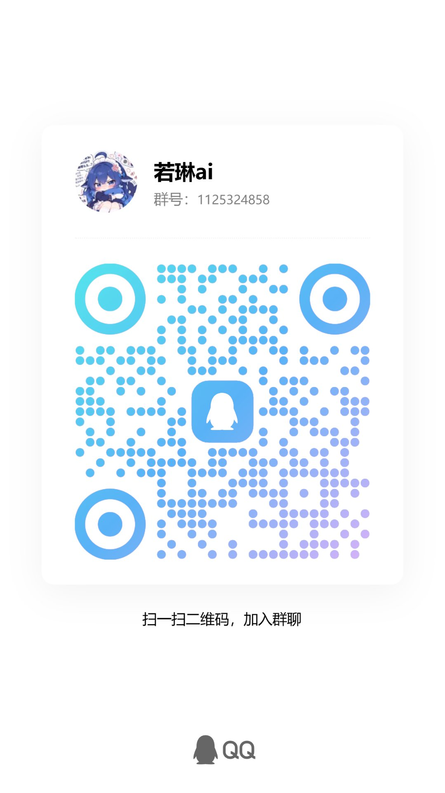

# 若琳AI送（销）货单管理系统 · 单机版 —— 部署说明

> 一句话：**纯 PHP 系统，不需要数据库、不需要装任何第三方库和插件**。
> 把文件夹放进网站目录，浏览器打开 `ticket.php` 就能用。

---

## 目录

1. [环境要求](#一环境要求)
2. [部署方式](#二部署方式)
3. [目录权限（云服务器必看）](#三目录权限云服务器必看)
4. [需要开放的端口](#四需要开放的端口)
5. [首次使用：5 件事](#五首次使用5-件事)
6. [数据文件说明与备份](#六数据文件说明与备份)
7. [日常使用（管理员手册）](#七日常使用管理员手册)
8. [上传 GitHub 前必读（重要）](#八上传-github-前必读重要)
9. [常见问题 FAQ](#九常见问题-faq)
10. [官方群聊](#十官方群聊)

---

## ⚠️ 必看：装完第一件事——目录所有者必须是 `www`

这一步不做，**开票一定保存失败**；宝塔上传的文件夹默认属主是 `root`，几乎 100% 会踩到。

1. 宝塔 → 文件 → 进入站点目录
2. `票据留存` → 权限 → **所有者 `root` 改成 `www`** → 勾「应用到子目录」→ 应用
3. **站点根目录再做一遍**
4. 开一张测试单验证：能正常生成即配好；万一失败，系统会弹出一页说明，直接告诉你哪个目录不可写

（本地 Windows 运行无此问题。详细步骤见第三节。）

---

## 一、环境要求

| 项目 | 要求 |
|---|---|
| PHP | 7.4 及以上（推荐 8.x，8.2 实测通过） |
| 数据库 | **不需要** ❌ 不用建库、不用配 MySQL |
| 第三方库 / 插件 | **不需要** ❌ 不用 Composer、不用 npm |
| Web 服务 | Apache / Nginx / PHP 内置服务器 任选 |
| 磁盘 | ≥ 200 MB |
| 需要开放的端口 | 见第四节 |

**结论：一台装了 PHP 的普通虚拟主机 / 轻量服务器就够，1 核 1G 也能跑。**

---

## 二、部署方式

### 方式一：Windows 本机运行（最简单，适合单机使用）

1. 安装 PHP：
   - 到 https://www.php.net/downloads 下载 **Non Thread Safe** 的 zip 包，解压到如 `D:\php`
   - 或直接安装 **phpStudy / XAMPP**，自带 PHP
2. 把 `php.exe` 所在目录加入环境变量 PATH（phpStudy/XAMPP 用户可跳过，直接用它们的面板建站）
3. 在本目录打开命令行（地址栏输入 `cmd` 回车），执行：

```bat
php -S 127.0.0.1:8899
```

4. 浏览器打开 `http://127.0.0.1:8899/ticket.php`

> 关掉命令行窗口服务就停了；想开机自启可以写一个 `启动.bat`：
> ```bat
> @echo off
> cd /d %~dp0
> start "" php -S 127.0.0.1:8899
> start "" http://127.0.0.1:8899/ticket.php
> ```

### 方式二：宝塔面板（云服务器，推荐正式使用）

1. 宝塔 → **网站** → 添加站点：
   - 域名填你的域名（或先填服务器 IP）
   - PHP 版本选 **7.4 及以上**
   - 不要创建数据库
2. 把本目录**全部文件**（含 `.htaccess`、`官方群聊.jpg`）上传到站点根目录（如 `/www/wwwroot/你的域名/`）
3. 按**第三节**改目录所有者为 `www`
4. （可选）申请免费 SSL 证书：网站 → 设置 → SSL → Let's Encrypt
5. 浏览器访问 `http://你的域名/ticket.php`

### 方式三：虚拟主机 / 其他面板

上传全部文件到 `public_html`（或 `wwwroot`），确保 PHP ≥ 7.4，访问 `ticket.php`。目录写不了就找主机商开写权限。

---

## 三、目录权限（云服务器必看）

PHP 以 `www` 用户运行，宝塔上传的文件属主是 `root`——**只改 755 权限不改属主是没用的**，`www` 仍然不是属主，照样写不进去。

### 宝塔面板怎么改（图形化，不用敲命令）

**`票据留存` 和站点根目录两处都要改**（只改一处会出现「票能生成但数据存不进去」的半死状态）：

1. 宝塔 → **文件** → 进入站点目录（如 `/www/wwwroot/你的域名/`）
2. 找到 **票据留存** 文件夹 → 点右侧「权限」
3. 在弹窗里：
   - **「权限， 所有者」下拉框：`root` 改成 `www`**（最关键的一步）
   - 所有者：读取 ✓ 写入 ✓ 执行 ✓（755）
   - 用户组、公共：读取 ✓ 执行 ✓
   - **勾选「应用到子目录」**
4. 点「应用」
5. 对**站点根目录**重复以上步骤

### SSH 命令写法（等价）

```bash
chown -R www:www /www/wwwroot/你的站点目录
chmod -R 755 /www/wwwroot/你的站点目录
```

### 怎么验证

开一张测试单：能正常跳到票据页、宝塔文件管理里能看到 `票据留存/当天日期/单号.html`，就说明权限已修好。

万一写入失败，系统会**拒绝保存**并返回一页中文说明，里面直接列出**失败的确切路径**、PHP 运行用户、磁盘剩余等自检信息，照着提示改即可。

---

## 四、需要开放的端口

> 本机运行（方式一）不需要对外开放任何端口。

正式部署（云服务器）**只对外开 80 和 443，其他一律不开**：

| 端口 | 用途 | 要求 |
|---|---|---|
| **80** | HTTP，申请免费 SSL 证书也要用 | ✅ 必须，对所有人 |
| **443** | HTTPS 正式访问 | ✅ 配了证书就必开 |
| **22** | SSH 运维 | ⚠️ 只放自己的固定 IP |
| **8888** | 宝塔面板 | ⚠️ 可选，只放自己 IP，建议改端口 |
| 3306 / 6379 / 21 | MySQL / Redis / FTP | ❌ 全部不放行（本系统无数据库，没有理由开） |

**三处都要放行，缺一处就不通**：

1. **云厂商安全组**（阿里云/腾讯云控制台 → 安全组 → 添加入站规则）
2. **服务器防火墙**：
   ```bash
   # CentOS (firewalld)
   firewall-cmd --permanent --add-service={http,https} && firewall-cmd --reload
   # Ubuntu (ufw)
   ufw allow 80/tcp && ufw allow 443/tcp
   ```
3. **宝塔「安全」页**：放行 80、443

**验证方法**：在你自己电脑上执行 `curl -I http://你的域名`。
⚠️ 最容易误判：**服务器上 `curl localhost` 能通 ≠ 公网能通**，安全组没开时本机测永远通。

---

## 五、首次使用：5 件事

1. **设置品牌/送货系统名称**：页面右上角「编辑」，填你的送货系统名称（显示在票据抬头上）
2. **添加常用人员**：制票人、送货人加进常用名单，**排第一位的自动成为默认值**
3. **开一张测试单**验证保存正常（云服务器重点验证第三节）
4. **熟悉历史单按钮**：查看/打印、复制重开、下载、打开位置（仅 Windows 本机）、删除
5. **设置备份**（正式使用后）：见第六节

---

## 六、数据文件说明与备份

| 文件/目录 | 内容 | 重要性 |
|---|---|---|
| `ticket_data.json` | 全部单据数据 | ⭐⭐⭐ |
| `票据留存/` | 每张票的 HTML 存档（按日期分目录） | ⭐⭐⭐ |
| `people.json` | 制票人/送货人名单 | ⭐⭐ |
| `settings.json` | 品牌/送货系统名称 | ⭐ |

### 一条命令备份（云服务器）

```bash
cd /www/wwwroot
tar -czf backup_$(date +%Y%m%d).tar.gz 你的站点目录/ticket_data.json 你的站点目录/people.json 你的站点目录/settings.json 你的站点目录/票据留存
```

### 宝塔自动备份

宝塔 → **计划任务** → 添加 → 备份目录 → 选站点目录 → 每天 3 点。

**恢复**：把备份解压覆盖回原位置即可。所有文件都是普通 JSON/HTML，没有加密，任何时候都能直接看。

---

## 七、日常使用（管理员手册）

### 7.1 开一张新单

1. 填收货单位、地址（选填）
2. 制票人 / 送货人：从下拉选（第一位是默认值），也可现场输入（会自动加进常用名单）
3. 货物明细：可「+ 添加」多行，可删除行
4. 合计、大写金额自动计算，**单号和开票时间自动生成，不可手改**
5. 点「保存并生成送（销）货单」→ 自动跳到票据页

### 7.2 历史单五个按钮

| 按钮 | 作用 | 注意 |
|---|---|---|
| 🔵 查看/打印 | 打开票据页打印（A4） | 缺快照的老票会自动补写 |
| 🟢 复制重开 | 整单内容填回新单表单，可修改后重开 | 单号、时间、合计重新生成 |
| 🟢 下载 | 存成 `单号.html`，可存档/发客户 | 下载的是开票时的原样票据 |
| 🟠 打开位置 | 在资源管理器定位票据文件 | **仅 Windows 本机可见**，云服务器自动隐藏 |
| 🔴 删除 | 删掉这条记录 + 票据文件，**不可恢复** | 会二次确认 |

**批量删除**：每行最左侧复选框，表头可全选；勾选后点「🗑 删除所选（数量）」一次删多张，同样二次确认。

### 7.3 导入老票 / 导出 CSV

- **导入**：点「⇪ 导入票据」→ 上传 `.html`（Ctrl 多选）或扫描留存目录；重复单号自动跳过；**导入票的品牌与开票时间锁定不变**
- **导出**：导入旁边的两个日期框 + 「导出 CSV」，按**开票时间**区间导出；留空 = 全部；文件名自带区间

### 7.4 统计口径

「今日金额」「累计金额」只统计**开票时间**在范围内的单据，导入的老票按票面时间算，不算导入时间。

---

## 八、上传 GitHub 前必读（重要）

仓库已配好 `.gitignore`，以下**敏感/数据文件不会被提交**，请勿 `git add -f` 强推：

```
ticket_data.json    # 真实单据数据
people.json         # 员工名单
settings.json       # 品牌设置
票据留存/            # 票据存档（含客户信息）
log.png             # 品牌 Logo
```

### 上传步骤

```bash
cd 本目录
git init
git add .
git commit -m "first commit"
git branch -M main
git remote add origin https://github.com/你的用户名/仓库名.git
git push -u origin main
```

> 上传前建议自己再搜一遍：`findstr /s /m "真实人名 商户名" *.php *.json *.md`（Windows），
> 确认代码和文档里没有残留真实客户姓名、电话、地址。

---

## 九、常见问题 FAQ

| 现象 | 原因 | 解决 |
|---|---|---|
| 开票后提示「**票据文件没能写入服务器，本次开单未保存**」 | `票据留存/` 属主是 `root`，PHP 跑 `www` | **宝塔：票据留存 → 权限 → 所有者 `root` 改 `www`、勾「应用到子目录」**（第三节有图说）；提示页里自带自检表，照着改即可 |
| 历史里有单子，点开是空白 | 早期目录不可写，快照没生成 | 按第三节修好权限；再看一次那张票会自动补写快照 |
| 下载的文件打不开 | 下载被浏览器拦截或改了扩展名 | 文件是标准 HTML，用浏览器打开即可；别用记事本改后缀 |
| 票据打印出来第二页是空白 | 浏览器打印边距 | 打印预览里勾「背景图形」，边距选「默认」 |
| 导入的票时间不对 | 老票票面只有日期没有时间 | 系统按票面日期统计，显示「原票未记时间」，正常现象 |
| 手机上表格挤在一起 | 正常现象 | 表格支持左右滑动；已对手机全面适配 |
| CSV 打开乱码 | Excel 编码 | 文件自带 BOM，正常双击打开不乱码；若乱码请用「数据 → 从文本导入」 |
| 页面 403 / 目录禁止访问 | Apache 未加载 mod_rewrite | `.htaccess` 里的安全规则依赖它；不加载也能用，但建议开启 |

---

## 十、官方群聊

部署 / 使用遇到问题？扫码进官方群，直接在群里问（图片 `官方群聊.jpg`，可点击放大）：

<p align="center"><a href="官方群聊.jpg" target="_blank"></a></p>

> **群名称**：若琳ai　|　**QQ 群号**：`1125324858`
> 装不上、域名没配好、票据导不进去，都可以在群里直接问。
> 手机扫码：QQ「扫一扫」对准上图即可加群；也可以在 QQ 里直接搜群号加入。

---

## 更新记录

| 日期 | 内容 |
|---|---|
| 2026-11-01 | 首个开源版本：开票锁定、票据留存、导入老票、批量删除、按日期导出 CSV、手机适配、安全加固 |
